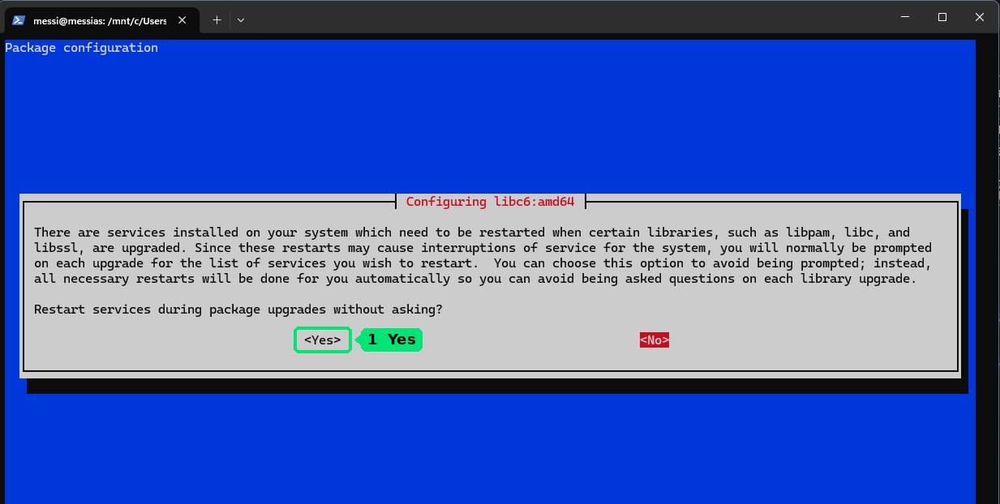
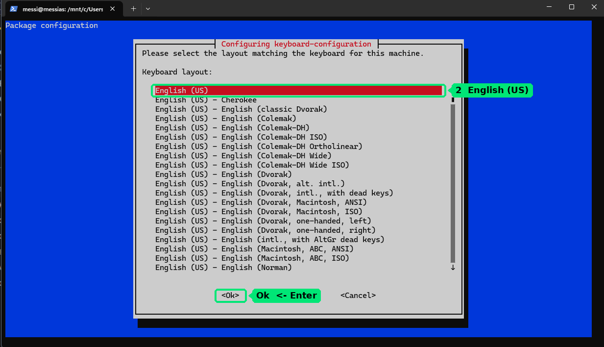
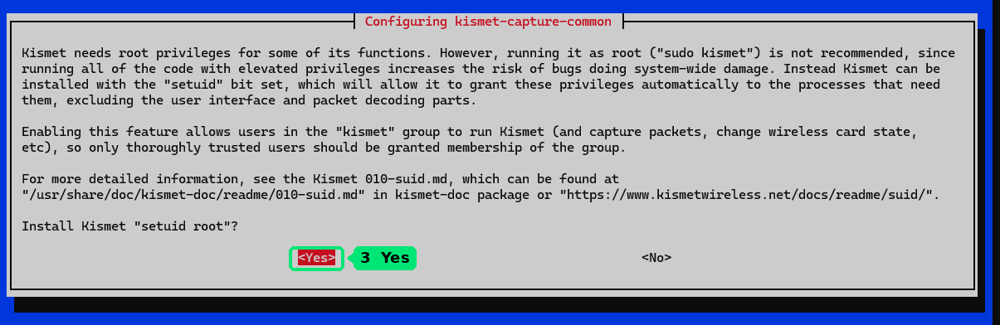
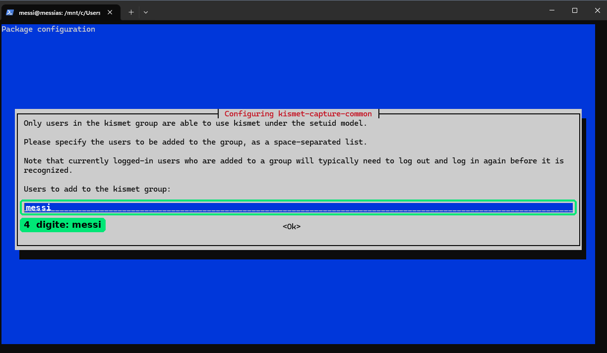
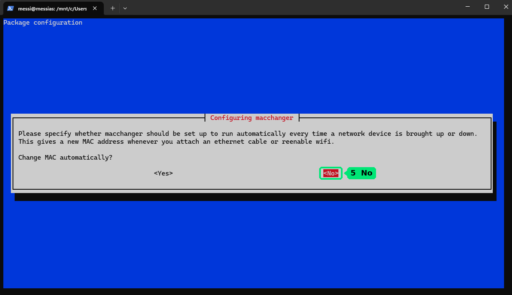
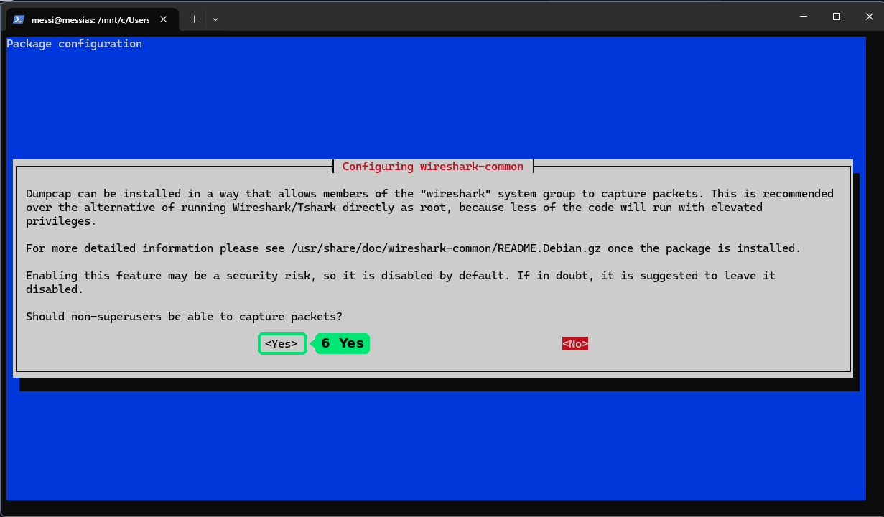
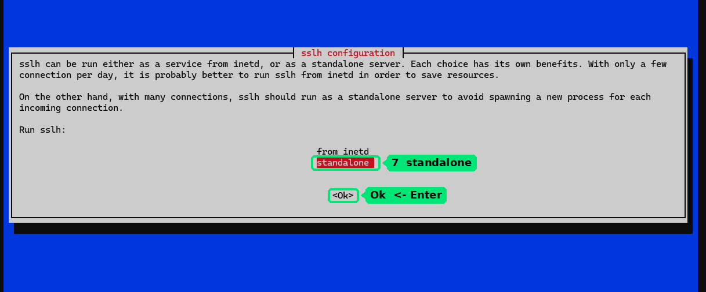

# 🐉 Kali Linux no WSL2 — Guia de Instalação

> Passo a passo para instalar o **Kali Linux** no Windows via **WSL2**, com as ferramentas de pentest (`kali-linux-headless`), wordlists (`seclists`, `rockyou`) e interface gráfica (**Win-KeX**).

---

## 📋 Sumário

| # | Etapa | Onde rodar |
|---|-------|-----------|
| 1 | [Instalar o Kali no WSL](#1️⃣-instalar-o-kali-no-wsl) | PowerShell (Windows) |
| 2 | [Atualizar e instalar as ferramentas](#2️⃣-atualizar-e-instalar-as-ferramentas) | Terminal do Kali |
| 3 | [Responder as telas de configuração](#3️⃣-telas-de-configuração) | Terminal do Kali |
| 4 | [Descompactar a rockyou](#4️⃣-descompactar-a-rockyoutxt) | Terminal do Kali |
| 5 | [Interface gráfica (Win-KeX)](#5️⃣-interface-gráfica-com-win-kex) | Terminal do Kali |

---

## 1️⃣ Instalar o Kali no WSL

Abra o **PowerShell** (de preferência como Administrador) e rode:

```powershell
wsl --install -d kali-linux
```

> 💡 Ao final, o Kali abre sozinho e pede para criar **usuário** e **senha** do Linux.
> Se for a primeira vez usando WSL, o Windows pode pedir para **reiniciar**.

---

## 2️⃣ Atualizar e instalar as ferramentas

Já dentro do Kali:

```bash
sudo apt update && sudo apt upgrade -y && sudo apt install -y kali-linux-headless seclists wordlists
```

| Pacote | O que é |
|--------|---------|
| `kali-linux-headless` | Ferramentas padrão do Kali (sem interface gráfica) |
| `seclists` | Coleção enorme de wordlists → `/usr/share/seclists` |
| `wordlists` | Wordlists clássicas, incluindo a `rockyou` → `/usr/share/wordlists` |

> ⏳ Esse comando demora. No meio da instalação vão aparecer **7 telas azuis** — veja a próxima seção.

---

## 3️⃣ Telas de configuração

### ⌨️ Como navegar nas telas

| Tecla | Ação |
|-------|------|
| `Tab` ou `←` `→` | Alterna entre `<Yes>` / `<No>` / `<Ok>` |
| `↑` `↓` | Move na lista de opções |
| `Enter` | Confirma |

> ⚠️ **Atenção:** a opção que já vem marcada em **vermelho** nem sempre é a que queremos!
> Siga sempre o que está destacado em **🟩 verde** nas imagens.

### ✅ Resumo rápido

| # | Tela | Resposta |
|---|------|----------|
| 1 | `libc6` — reiniciar serviços sem perguntar? | **Yes** |
| 2 | `keyboard-configuration` — layout do teclado | **English (US)** (só confirmar) |
| 3 | `kismet` — instalar com setuid root? | **Yes** |
| 4 | `kismet` — usuários do grupo kismet | **messi** (seu usuário) |
| 5 | `macchanger` — trocar MAC automaticamente? | **No** |
| 6 | `wireshark` — usuários comuns capturam pacotes? | **Yes** |
| 7 | `sslh` — modo de execução | **standalone** |

---

### Tela 1 — `libc6`: reiniciar serviços sem perguntar → **Yes**

A tela vem com `<No>` marcado — use `Tab`/`←` para ir até **`<Yes>`** e dê `Enter`.



---

### Tela 2 — Layout do teclado → **English (US)**

Só confirme: **English (US)** já vem selecionado, aperte `Enter` no **`<Ok>`**.



---

### Tela 3 — Kismet "setuid root" → **Yes**



---

### Tela 4 — Usuários do grupo kismet → **messi**

Digite o nome do **seu usuário** do Kali (no nosso caso, `messi`) e dê `Enter`.



> 💡 Não sabe seu usuário? Rode `whoami` em outro terminal.

---

### Tela 5 — Macchanger: trocar MAC automaticamente → **No**



---

### Tela 6 — Wireshark: usuários comuns podem capturar pacotes → **Yes**

A tela vem com `<No>` marcado — vá até **`<Yes>`** e dê `Enter`.



---

### Tela 7 — sslh → **standalone**

Use `↓` para selecionar **standalone** e depois `Enter` no **`<Ok>`**.



> 🎉 Pronto! Agora é só esperar a instalação terminar.

---

## 4️⃣ Descompactar a `rockyou.txt`

A wordlist mais famosa vem compactada. Para descompactar:

```bash
sudo gzip -d /usr/share/wordlists/rockyou.txt.gz
```

Ela fica em: **`/usr/share/wordlists/rockyou.txt`**

---

## 5️⃣ Interface gráfica com Win-KeX

Instale o **Win-KeX** (interface gráfica do Kali dentro do Windows):

```bash
sudo apt install -y kali-win-kex
```

### ▶️ Iniciar

```bash
kex --win -s
```

> `--win` abre em janela · `-s` ativa o som
> Na primeira vez ele pede para criar uma **senha do VNC**.

### 🎛️ Menu de opções

Com a janela do KeX aberta, aperte **`F8`** para abrir o menu — lá dá para **desconectar**, entrar/sair de tela cheia, etc.

---

## 🤖 Modo automático (Ansible)

As etapas **2 a 5** podem rodar sozinhas com o playbook da pasta [`ansible/`](ansible/) (guia completo em [`ansible/README.md`](ansible/README.md)) — mesmo padrão do [orion-workstation](https://github.com/messias-code/orion-workstation). As **7 telas azuis** são pré-respondidas via `debconf`, então nenhuma aparece.

```bash
# depois do "wsl --install -d kali-linux" (etapa 1, no Windows)
sudo apt update && sudo apt install -y ansible git
cd ansible
ansible-playbook playbooks/site.yml   # pede a senha do sudo uma vez
```

| Arquivo | Para quê |
|---------|----------|
| `inventory/group_vars/all.yml` | Liga/desliga cada etapa (`true`/`false`) |
| `roles/kali_tools/defaults/main.yml` | Pacotes e respostas das 7 telas |

> 💡 O usuário do kismet/wireshark é detectado automaticamente (quem rodou o playbook).
> A **senha do VNC** do Win-KeX continua sendo criada no primeiro `kex --win -s`.

---

## 🧾 Cola rápida

```bash
# Windows (PowerShell)
wsl --install -d kali-linux

# Kali
sudo apt update && sudo apt upgrade -y && sudo apt install -y kali-linux-headless seclists wordlists
sudo gzip -d /usr/share/wordlists/rockyou.txt.gz
sudo apt install -y kali-win-kex
kex --win -s        # F8 = menu / desconectar
```
